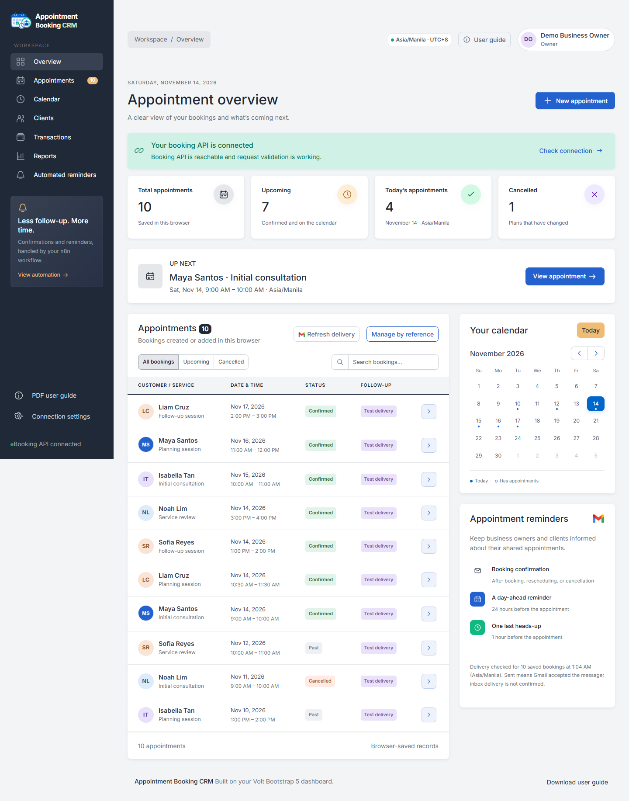
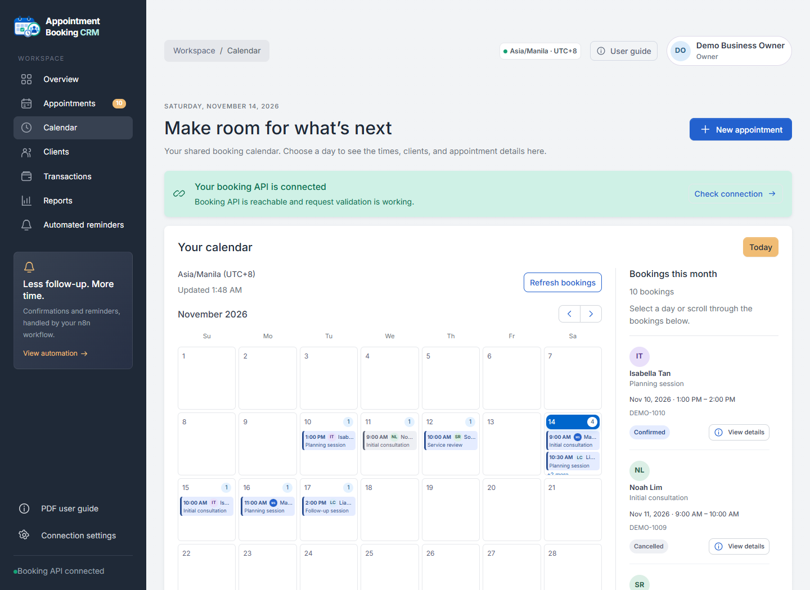
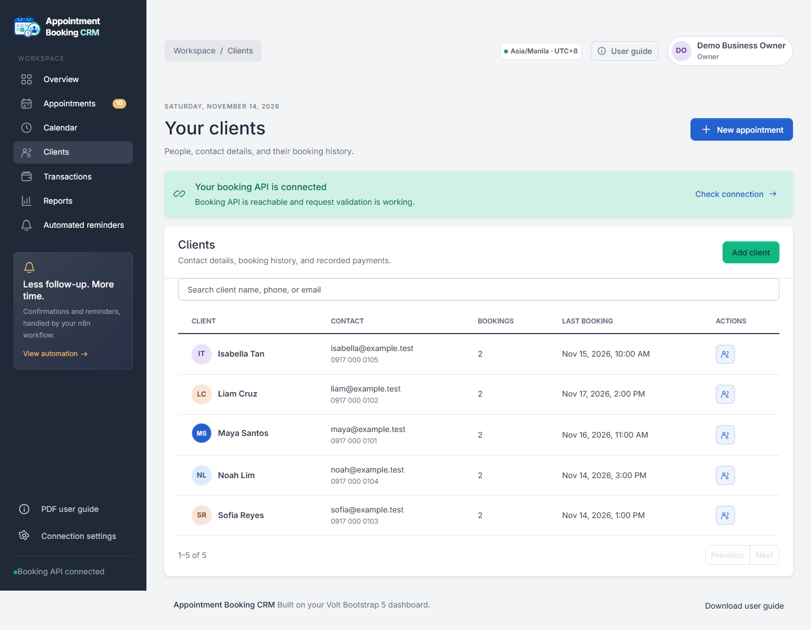
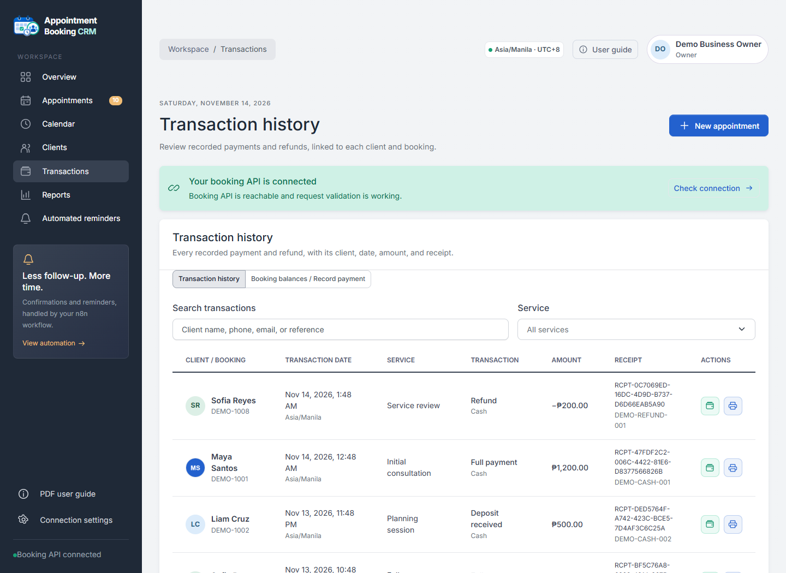
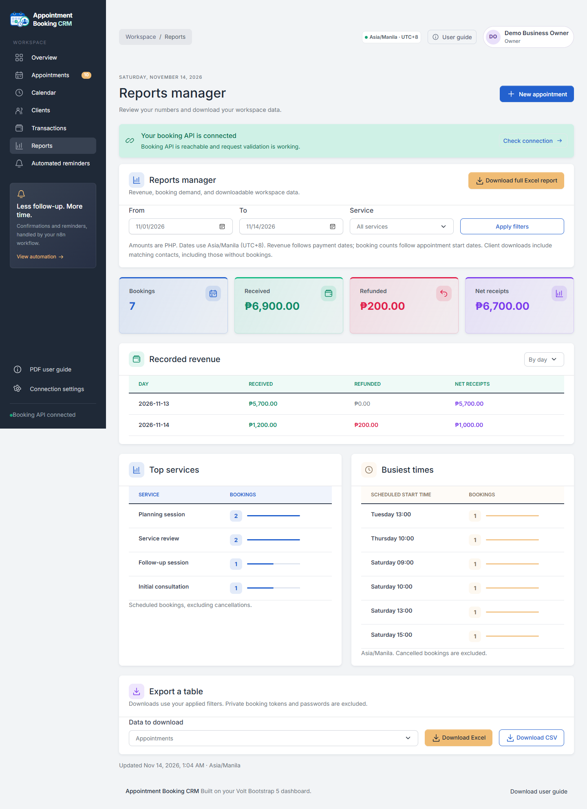
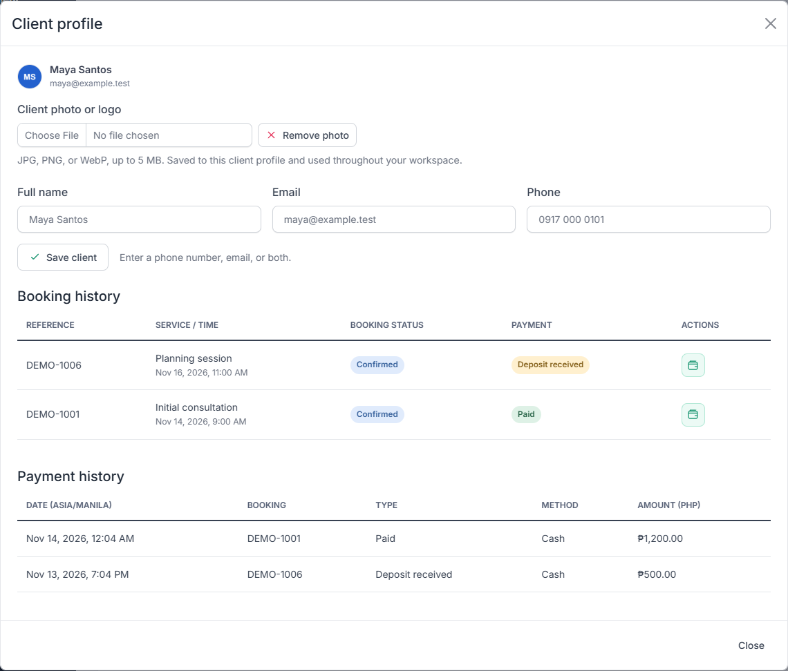
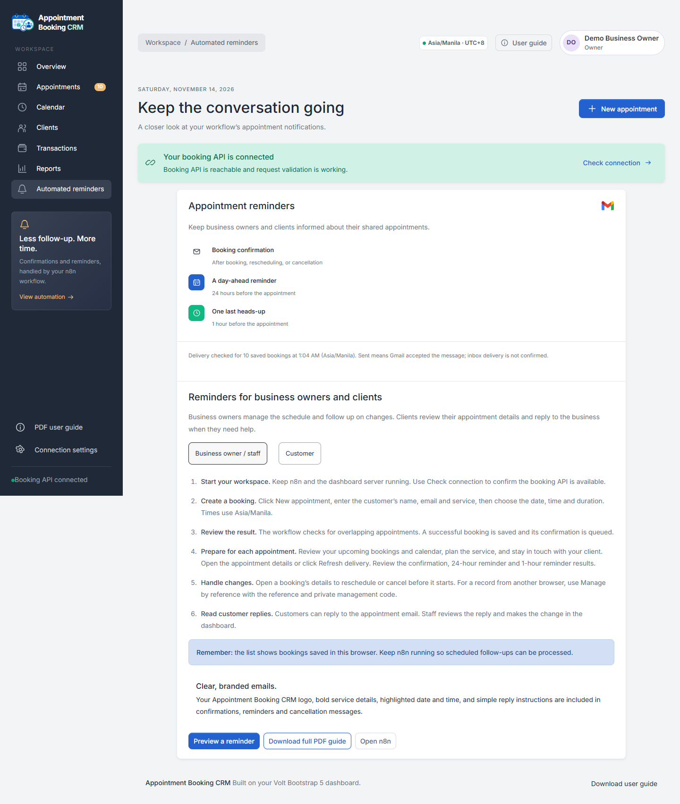
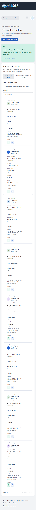
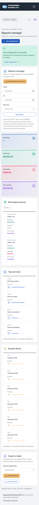

# Automated Follow-Up Appointment Booking CRM

A local appointment workspace for business owners and staff, built with **Volt / Bootstrap 5**, Node.js, SQLite, and n8n. Manage bookings, keep client profiles and photos consistent, record cash transactions, and review revenue and demand reports.



**Every screenshot uses fictional demo data.** The screenshot generator runs the real application with a disposable database and local mock booking API. It never reads production records, contacts Gmail, or sends email.

## Application screenshots

| Calendar | Clients |
| --- | --- |
|  |  |
| Transaction history | Reports |
|  |  |
| Client profile | Automated reminders |
|  |  |

<details>
<summary>Mobile screenshots</summary>

 

</details>

## Features

- Appointment creation, overlap checks, rescheduling, cancellation, and booking references.
- A shared calendar with appointment details and a scrollable agenda.
- Client contacts, booking/payment history, and photos or logos shared across dashboard pages.
- Transaction history with one row per recorded payment/refund and printable receipts.
- Cash payment, deposit, partial payment, balance, and refund recording. No payment gateway or card charging.
- Owner-only revenue/demand reports with native Excel and CSV downloads.
- Owner/staff sign-in, account management, CSRF protection, and an activity audit log.
- n8n/Gmail confirmations and eligible 24-hour and 1-hour client reminders.
- Separately confirmed receipt emails when the optional sender is configured.
- Responsive Volt components and consistent Bootstrap action colors.

## Run locally

Install **Node.js 22.17 or newer** with `node:sqlite` available, and Git.

```powershell
git clone https://github.com/adam-Dev2002/Automated-Follow-Up-Appointment-Booking-CRM.git
cd Automated-Follow-Up-Appointment-Booking-CRM
npm install
npm run dev
```

On Windows PowerShell, use `npm.cmd` if script execution policy blocks `npm`.

Open **http://localhost:3002** and create your first owner account. There are no published production accounts or passwords. Keep the terminal open; source changes rebuild automatically.

The dashboard starts before n8n is configured. For real bookings and automatic emails, follow [the n8n setup instructions](docs/SETUP.md). The default booking upstream is `http://localhost:5678/webhook/appointments-api`.

## Generate demo screenshots

```powershell
npx playwright install chromium
npm run screenshots
```

This creates ten PNGs in `docs/screenshots/` using fictional clients, bookings, cash receipts, refunds, and a sample client logo. Temporary accounts/databases are removed when the command finishes. Your running workspace is not changed.

## Using the application

1. **Appointments:** create a booking, or open a record to reschedule/cancel before its start time.
2. **Calendar:** select a day or open a booking from the month/agenda.
3. **Clients:** open a linked name/avatar to edit contact details and upload a photo or logo.
4. **Transactions:** review recorded receipts/refunds. Choose **Booking balances / Record payment** to set a booking price and record money already received.
5. **Receipts:** print a transaction or separately review and confirm an email receipt.
6. **Reports:** filter dates/services and download Excel/CSV files. Only owners can access Reports.

Full instructions: [Owner/staff/customer guide](USER-GUIDE.md) | [Setup](docs/SETUP.md) | [Testing](TESTING-GUIDE.md).

## Development and checks

```powershell
npm run check
npm run test:security
npm run test:crm
npm run test:transactions
npm run test:receipts
npm run test:calendar
npm run build
```

Browser checks need Chromium or an installed supported browser. Financial, account, calendar, receipt, and screenshot checks use isolated fixtures and temporary databases. `npm run test:dashboard` also checks the configured local booking connection; see [Testing](TESTING-GUIDE.md).

`npm run build` creates static files in `dist/`; the Node server is still required for sign-in and `/api/*`. Generate the downloadable guide with `npm run guide:pdf`.

## Project structure

```text
src/             Volt pages, partials, shared client identities, and styles
scripts/         Local API, SQLite stores/migrations, verification, and demo capture
workflow/        Inactive n8n templates and table schemas; bind your own resources
docs/            Setup instructions and fictional demo screenshots
.local/          Private runtime data; ignored by Git
```

## Current boundaries

The overview/appointment list retains browser-saved booking references. Calendar, Clients, and booking balances use the protected shared n8n source. Transaction history and client photos persist in SQLite.

Customer self-service accounts, public self-booking, staff-specific calendars, and SMS automation are not implemented. The default appointment workflow sends email reminders to the client. Owner-email preference code is preparatory; owner copies require a separately reviewed workflow installation. A Gmail **Sent** result confirms provider acceptance, not guaranteed inbox delivery.

Private databases, sessions, operator tokens, API keys, live verification reports, backups, logs, and real client images are excluded. Workflow templates are inactive and contain no account credential bindings or live customer rows.

## Credits and license

The interface extends [Volt Bootstrap 5 Dashboard by Themesberg](https://github.com/themesberg/volt-bootstrap-5-dashboard). Original template copyright notices are preserved. See [LICENSE.md](LICENSE.md) for the MIT license.
